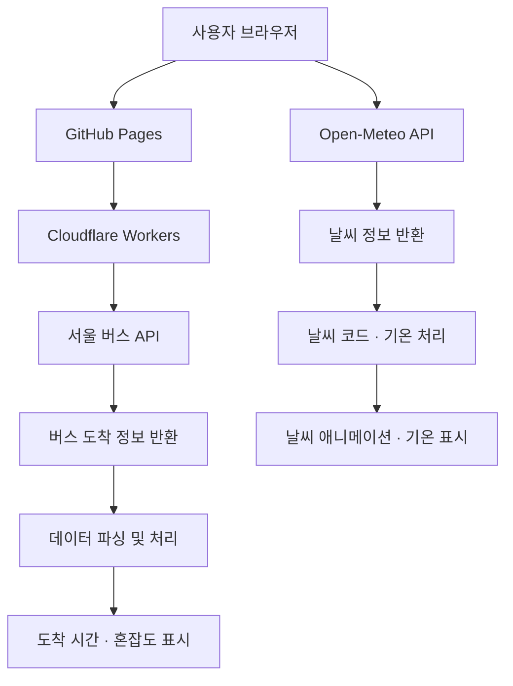

# 서울 버스 도착 정보 확인

서울 버스 API를 이용해 버스 도착 예정 시간을 확인하고, 정류장까지의 도보 시간을 고려해 탑승 여유 시간을 계산하는 웹 애플리케이션입니다. Open-Meteo 날씨 API를 연동하여 현재 날씨와 기온도 함께 제공합니다.

## 주요 기능

### 버스 도착 정보
- **실시간 도착 조회**: 서울 버스 API를 통한 도착 예정 시간 확인
- **버스 전환**: 두 개의 버스 정보를 간편하게 전환
- **정류소 정보 표시**: 정류소 이름과 버스 번호 표시
- **다음 버스 안내**: 현재 버스와 다음 버스의 도착 시간 표시

### 버스 혼잡도
- **혼잡도 안내**: 버스 상태를 여유, 보통, 혼잡으로 구분하여 표시

### 탑승 가능 시간 계산
- **도보 시간 설정**: 정류소까지 이동 시간 선택
- **탑승 여유 시간 계산**: 버스 도착 시간과 도보 시간을 비교
- **탑승 상태 안내**: 남은 시간에 따라 여유, 서둘러 이동, 시간 촉박 상태 표시

### 날씨 정보
- **실시간 날씨 조회**: Open-Meteo API를 통한 현재 날씨 정보 확인
- **날씨 애니메이션**: 날씨 코드에 따라 애니메이션 표시
- **기온 표시**: 현재 기온을 메인 화면에 표시

### 사용자 편의 및 오류 처리
- **오류 안내**: API 요청 및 응답 오류 발생 시 상태 메시지 표시
- **파비콘 적용**: 브라우저 탭과 모바일 환경에 맞는 아이콘 제공
- **반응형 화면 구성**: 모바일 환경에 적합한 화면 배치

## 기술 스택

| 구분 | 기술 |
|---|---|
| 프런트엔드 | HTML, CSS, JavaScript |
| 버스 정보 | 서울 버스 도착 정보 API |
| 날씨 정보 | Open-Meteo API |
| 애니메이션 | Lottie Web, Meteocons |
| 서버 및 API 중계 | Cloudflare Workers |
| 웹 호스팅 | GitHub Pages |
| 응답 데이터 | XML, JSON |
| 웹 폰트 | Pretendard |

## 서비스 구조

## API 연동

### 서울 버스 API
- 서울 버스 도착 정보 API 연동
- XML 응답 데이터 파싱
- 버스 도착 시간 및 혼잡도 정보 표시
- Cloudflare Workers를 통한 API 요청 중계

### Open-Meteo API
- 현재 날씨 및 기온 정보 조회
- JSON 응답 데이터 파싱
- 날씨 코드에 따른 애니메이션 연결
- 메인 화면에 현재 기온 표시

## 주요 기능 요약

- 실시간 버스 도착 정보 조회
- 현재 버스 및 다음 버스 도착 시간 표시
- 버스 혼잡도 안내
- 도보 시간을 고려한 탑승 여유 시간 계산
- 현재 날씨 및 기온 표시
- 날씨 상태에 따른 애니메이션 표시

※ 실제 탑승 가능 여부는 교통 상황, 도착 정보 갱신 시점 및 보행 속도에 따라 달라질 수 있습니다.

## 보안 및 배포

- 버스 API 인증 정보는 프런트엔드에 노출하지 않습니다.
- Cloudflare Workers를 통해 버스 API 요청을 중계합니다.
- 웹페이지는 GitHub Pages를 통해 배포합니다.
- 날씨 정보는 Open-Meteo API를 통해 조회합니다.

## 프로젝트 주소

- 웹페이지: [https://harteh.github.io/seoul-bus-check/](https://harteh.github.io/seoul-bus-check/)
- GitHub 저장소: [https://github.com/harteh/seoul-bus-check](https://github.com/harteh/seoul-bus-check)

## 향후 개선 사항

- 여러 정류소 및 노선 선택 기능
- 버스 도착 정보 자동 갱신
- 날씨 정보 자동 갱신
- API 요청 횟수 제한 및 오류 로그 관리
- 모바일 화면 최적화
